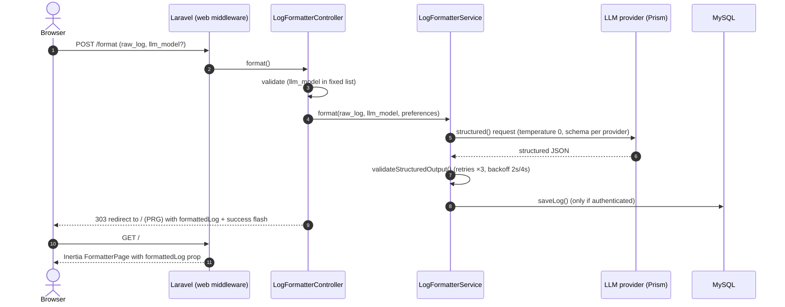

# Architecture overview

[Home](../Home.md) › [Architecture](index.md) › Architecture overview

> The runtime shape of StructLogr — components, the format request flow, who owns what data, and how it deploys.

| | |
| --- | --- |
| **Source** | `app/`, `routes/`, `config/`, `compose.yaml`, `composer.json`, `package.json` |
| **Owner** | architecture |
| **Last verified** | 2026-11-16 against `e89b491` |

## Components

| Piece | What it is | Where |
| --- | --- | --- |
| React 19 + Inertia SPA | Single-page frontend; pages under `resources/js/pages/`, no separate API for page data | [Frontend overview](../frontend/index.md) |
| Laravel 12 backend | Routes → `web` middleware → controllers → services → Eloquent | [Backend index](../backend/index.md) |
| Prism (`prism-php/prism`) | LLM client used for structured output | [LLM providers](../backend/llm-providers.md) |
| MySQL 8 | Production data store (Sail service `mysql`) | `compose.yaml` |
| Fortify | Two-factor authentication only (`config/fortify.php:152`); registration/login/etc. are custom controllers in `routes/auth.php` | `app/Providers/FortifyServiceProvider.php` |
| SQLite in-memory | Test database (`phpunit.xml`, `.env.testing`) | `tests/` |

No application jobs, listeners, or scheduled commands exist (`app/Jobs/` is absent; the `jobs` table is stock Laravel). All LLM calls are synchronous inside the `POST /format` request. Email (password reset, verification) uses Laravel's mailer, so production needs a configured `MAIL_*` set for those flows.

## Request flows

### Formatting a log (`POST /format`)

Notes:

- The redirect uses Post/Redirect/Get: the formatted output is passed via session flash (`->with('formattedLog', ...)`), not rendered by the POST itself.
- History saving only happens for authenticated users (`saveLog()` returns `null` for guests, `LogFormatterService.php:213-215`); formatting works without an account.
- The format POST is rate-limited only by the global web middleware group; there is no `throttle:` on it.

### Reading history (`GET /history*`)

The React hooks (`use-history`, `use-search`) call the JSON endpoints directly with `fetch`, using an `X-CSRF-TOKEN` header read from the page meta tag. These endpoints return `{ data: … }` JSON envelopes — not Inertia responses. See [API](../backend/api.md) and [History](../backend/history.md).

## Data ownership

| Store | Owns | Notes |
| --- | --- | --- |
| `formatted_logs` | Raw log text + structured JSON output + `title`, `summary`, `detected_log_type`, `field_count`, `is_saved` | Per `user_id`; soft-deleted (`SoftDeletes`); index on `(user_id, created_at)` (`2025_10_20_000000_update_formatted_logs_for_history.php`) |
| `users.preferences` | JSON preferences blob | Accessor merges stored value over defaults (`app/Models/User.php:61-85`) |
| `users` (2FA columns) | Fortify recovery codes / secret | Hidden + encrypted via Fortify |
| `cache`, `jobs`, cache/sessions | Stock Laravel tables | Unused by application code |

History entries keep the **raw log text** forever until the user clears them (soft delete). The `avoidSensitiveStorage` preference exists in the preferences blob but is not enforced anywhere in the formatter path — treat history as unsanitized.

## Runtime and deployment

- Local dev via Laravel Sail: `laravel.test` (PHP 8.4 FPM-ish app service) and `mysql` (MySQL 8) in `compose.yaml`. Ports are env-overridden: `APP_PORT` (README documents 8001), `FORWARD_DB_PORT` (3308), `VITE_PORT` (5175); compose defaults are 80 / 3306 / 5173.
- Build: `npm run build` (Vite 7); `npm run build:ssr` for the optional SSR bundle (`resources/js/ssr.tsx` is generated if used).
- Production checklist from Laravel applies: `config:cache`, `route:cache`, `view:cache`, `APP_DEBUG=false`.
- `public/.user.ini` disables `session.upload_progress` (interim PHP CVE mitigation; see README §Interim PHP Security Mitigation).

## Testing

Pest + PHPUnit against SQLite `:memory:` (`phpunit.xml`, `.env.testing`); `RefreshDatabase` per test. `SearchHistoryTest` runs the full history search flow. No browser or E2E suite exists.

## Sharp edges (known, ticketed)

- Unauthenticated `/debug/*` routes leak session id, CSRF token preview, and session config — SLOG-001.
- Every Inertia response shares a `csrf_debug` object with `session_id` and token preview — SLOG-002.
- `Ctrl/Cmd+K` both clears the formatter textarea and opens the search dialog — SLOG-007.
- Search uses `LIKE '%…%'` with no index — adequate at current scale; documented in [History](../backend/history.md).

## Related

- [API surface](../backend/api.md) — every route and who can call it
- [How formatting works](../backend/formatter.md) — the service pipeline in detail
- [Frontend overview](../frontend/index.md) — pages, hooks, and shared Inertia data

## Backlinks

<!-- wiki:backlinks:start -->
<!-- wiki:backlinks:end -->
